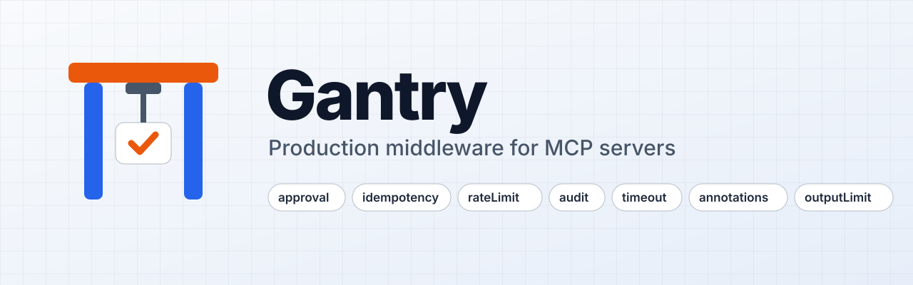
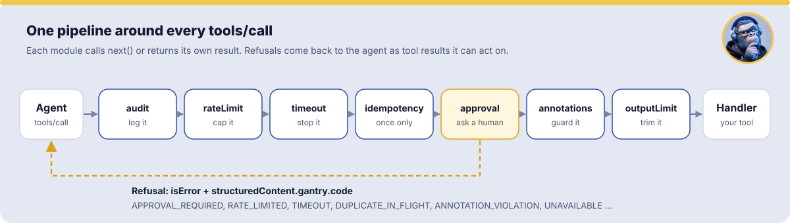
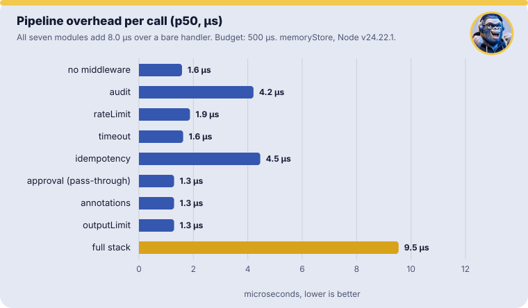

<p align="center">
  <picture>
    <source media="(prefers-color-scheme: dark)" srcset="assets/banner-dark.svg">
    
  </picture>
</p>

<p align="center">
  <a href="https://github.com/gorilli-team/gantry-mcp/actions/workflows/ci.yml"></a>
  <a href="https://www.npmjs.com/package/@gorilli/gantry-mcp"></a>
  
  
  
  <a href="LICENSE"></a>
</p>

<p align="center">
  <b>One pipeline around every MCP tool call</b>: human approval, idempotency, rate limits, audit, timeouts, output limits and annotation enforcement, with the testing tools to prove it works.
</p>

---

Every MCP server that touches real data ends up writing the same code around its tools: ask a human before destructive writes, don't run a write twice when the agent retries, cap how often and how much, log what happened, stop slow calls, keep huge outputs out of the agent's context.

Gantry does it once, as composable middleware on the official TypeScript SDK. **Express did this for HTTP. Gantry does it for MCP tools.**

```ts
import { McpServer } from "@modelcontextprotocol/server";
import { gantry } from "@gorilli/gantry-mcp";
import { z } from "zod";

const server = new McpServer({ name: "crm", version: "1.0.0" });
const g = gantry(server, { use: gantry.recommended() });

g.tool(
  "delete_client",
  {
    description: "Delete a client and all its data",
    inputSchema: z.object({ clientId: z.string() }),
    annotations: { destructiveHint: true },
  },
  async ({ clientId }) => {
    await db.clients.delete(clientId);
    return { content: [{ type: "text", text: "Deleted" }] };
  },
);
```

The agent calls `delete_client`. The user is asked in their client and approves. The tool runs once, even if the agent retries. The call is rate limited, timed and audited, and its output is capped. `g.tool()` has the same signature as `server.registerTool()`.

## Install

```bash
npm install @gorilli/gantry-mcp @modelcontextprotocol/server zod
```

Node 22+, ESM. Works with SDK v2 (`@modelcontextprotocol/server`) and v1 (`@modelcontextprotocol/sdk`). There are no runtime dependencies beyond the SDK.

## How it works

<p align="center">
  
</p>

Each module is a plain `(ctx, next)` middleware. It calls `next()` or returns its own result. Refusals come back as tool results with a machine-readable code and text written for the model, so the agent knows what happened and what to do next:

```json
{
  "isError": true,
  "content": [{ "type": "text", "text": "Rate limit reached for send_email. Retry after 412s." }],
  "structuredContent": { "gantry": { "code": "RATE_LIMITED", "retryAfterSeconds": 412 } }
}
```

## Modules

| Module          | What it does                                                                                                                                                      | Docs                                        |
| --------------- | ----------------------------------------------------------------------------------------------------------------------------------------------------------------- | ------------------------------------------- |
| **audit**       | One redacted event per stage (received, refused, approved, executed, failed) with timing. Secrets and tokens never reach the sink.                                | [audit](docs/modules/audit.md)              |
| **rateLimit**   | Sliding window per principal, tool, session, globally or by a custom key, with retry-after.                                                                       | [rateLimit](docs/modules/rate-limit.md)     |
| **timeout**     | Aborts `ctx.signal` and tells the model the call may have partly run.                                                                                             | [timeout](docs/modules/timeout.md)          |
| **idempotency** | Retries return the stored result instead of running again. Concurrent duplicates wait for the first call.                                                         | [idempotency](docs/modules/idempotency.md)  |
| **approval**    | Propose, human approves, execute: in the client (`elicit`), two-call HMAC `token`, or `out-of-band` (Telegram, Slack, email).                                     | [approval](docs/modules/approval.md)        |
| **annotations** | A `readOnlyHint` tool that tries to write through `ctx.gantry.fetch` or a guarded client is stopped. Strict mode refuses write-looking tools without annotations. | [annotations](docs/modules/annotations.md)  |
| **outputLimit** | Truncates with a notice, summarizes, or refuses results that would flood the context.                                                                             | [outputLimit](docs/modules/output-limit.md) |

Use them all with `gantry.recommended()`, or pick any subset in any order:

```ts
import {
  audit,
  rateLimit,
  timeout,
  idempotency,
  approval,
  annotations,
  outputLimit,
} from "@gorilli/gantry-mcp/modules";

const g = gantry(server, {
  store: redisStore(redis), // shared by all modules
  principal: (req) => req.authInfo?.clientId ?? "anonymous",
  use: [
    audit({ sink: (e) => logger.info(e), redact: ["email", /secret/i] }),
    rateLimit({ perPrincipal: "60/min", perTool: { send_email: "10/hour" } }),
    timeout({ default: "30s" }),
    idempotency({ ttl: "24h" }),
    approval({ mode: "elicit", fallback: ["out-of-band"], secret: env.GANTRY_SECRET, notifier }),
    annotations({ enforce: true, strict: true }),
    outputLimit({ maxTokens: 8_000 }),
  ],
});
```

Already have tools? `g.wrapExisting()` wraps everything registered on the server so far, with no changes to your tools.

## Test it like any other code

```ts
import { gantryTest, gantryMatchers, clientProfiles } from "@gorilli/gantry-mcp/testing";
expect.extend(gantryMatchers);

const t = await gantryTest(g, {
  principal: "alice",
  clientCapabilities: clientProfiles.elicitation,
});

t.elicitation.respond({ action: "accept", content: { approve: true } });
await expect(t.call("delete_client", { clientId: "c1" })).resolves.toBeGantryOk();
expect(t.events).toContainEvent({ type: "approved", tool: "delete_client" });

await t.clock.advance(60_000); // fake clock for rate limits, TTLs and timeouts
```

You get a real MCP client and server in process, with no network, simulated client profiles and Vitest/Jest matchers. See [testing](docs/testing.md).

## Fast

<p align="center">
  
</p>

The full stack adds about **8 µs** per call at p50 on `memoryStore`, about 60× under the 0.5 ms budget. Reproduce it with `npm run bench`.

## Secure by default

- **Fail closed.** If a store, audit sink, notifier or principal resolver fails, the call is refused, never allowed.
- **Real approvals.** Tokens are HMAC-SHA256, bound to tool, arguments (RFC 8785 canonical hash), principal and session. They are verified in constant time and consumed atomically, so each works once.
- **No downgrades.** A failed or hidden elicitation never falls back to a weaker approval mode.
- **No secrets in logs.** Redaction runs before any sink, and tokens are scrubbed from every string.
- **Weak secrets don't start.** Configuration errors stop the server at startup, not on the first call.

Read the threat model, including what `token` approval mode does **not** protect against, in [SECURITY.md](SECURITY.md).

## Stores

`memoryStore()` for stdio and single instances. `redisStore()` (ioredis or node-redis) and `mongoStore()` for multiple instances. They live in `@gorilli/gantry-mcp/stores/*`, with the client as a peer dependency. Gantry warns you when `memoryStore` runs behind HTTP. See [stores](docs/stores.md).

## Examples

| Example                                                   | Shows                                                                          |
| --------------------------------------------------------- | ------------------------------------------------------------------------------ |
| [quickstart](examples/quickstart/server.ts)               | 40-line server with the recommended stack (`npm run example:quickstart`)       |
| [crm-server](examples/crm-server/server.ts)               | Realistic write-heavy server, every module configured, guarded database client |
| [telegram-approval](examples/telegram-approval/server.ts) | Out-of-band approval with Telegram buttons; the agent never sees a token       |

Each example runs in CI as an integration test.

## Roadmap

- [x] **v0.1** Pipeline, context, error contract, `memoryStore`, `audit`, `timeout`, `rateLimit`, testing harness
- [x] **v0.2** `idempotency`, `approval` (elicit and token), `outputLimit`
- [x] **v0.3** Out-of-band `approval`, `annotations`, Redis and MongoDB stores, `wrapExisting`
- [ ] **v1.0** API freeze, docs site, launch
- [ ] Multi-round-trip (`inputRequired`) approval for the 2026-07-28 protocol era
- [ ] Adapters for `fastmcp` and `mcp-handler`

## Contributing

Issues and pull requests are welcome. Read [CONTRIBUTING.md](CONTRIBUTING.md) and the [Code of Conduct](CODE_OF_CONDUCT.md). Report vulnerabilities privately as described in [SECURITY.md](SECURITY.md).

## License

[MIT](LICENSE) © Gorilli
